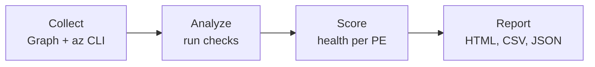
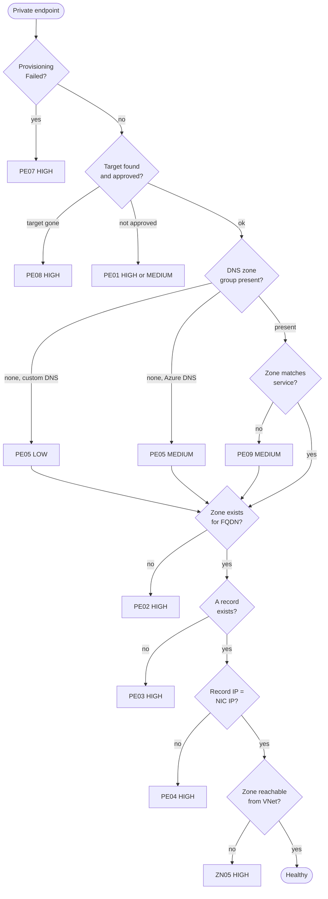

# pe_dns_audit.py: logic

Read-only auditor for Azure Private Endpoint (PE) and Private DNS correctness. Config-based: it checks what Azure says should resolve, not what actually resolves.

## Pipeline

## 1. Collect

| Source | Data | On failure |
|---|---|---|
| Resource Graph | PEs | Fatal (nothing to audit) |
| Resource Graph | NICs, VNets, privatelink zones | Notice added; dependent checks skipped |
| `az` per zone | A records, VNet links | Zone reported as AU01 (unreadable) |
| `az` per PE | DNS zone groups | Zone group, wrong-zone, link checks skipped for that PE |
| Resource Graph | Target resources (public access, existence) | Public-access and deleted-target checks skipped |

Zone, link and zone-group reads run in parallel (`--workers`, default 6).

## 2. Analyze

### Per-endpoint checks (in order)

The chain is shown as sequential for readability. In code, the checks after the approval gate run only for approved connections, and several (PE05, PE09) do not block the later A-record checks.

**ZN05 reachability** passes (or is downgraded) if the zone is:
1. Linked to the PE's VNet, or
2. Linked to a peered VNet, or
3. The VNet uses custom DNS (marked "Custom DNS", verify live).

FQDN to zone matching uses the public suffix of the zone name. `.vault.azure.net` is aliased to `.vaultcore.azure.net`.

### Estate-wide checks

| ID | Check | Severity |
|---|---|---|
| ZN01 | Zone has no VNet links | HIGH |
| ZN02 | Same zone name exists more than once (split DNS) | MEDIUM |
| ZN03 | Auto-registration enabled on a privatelink zone | MEDIUM |
| ZN04 | Link state not Completed | LOW |
| TG01 | Target has public network access on despite a PE | MEDIUM (LOW if firewall default is Deny) |
| RC01 | A record IP belongs to no scanned PE (AKS zones skipped) | LOW |
| NW01 | VNet with PEs uses custom DNS | INFO |
| AU01 | Zone unreadable | INFO |

## 3. Score

Each PE takes the worst severity among its findings.

| Worst finding | Status |
|---|---|
| HIGH | Failed |
| MEDIUM | Warning |
| LOW | Review |
| none | Healthy |
| PE06 only (no FQDN/IP data) | Unchecked |

## 4. Report

Written to the output folder:

- `report.html`: summary cards, findings table, endpoint table
- `findings.csv`: one row per finding, with suggested fix command
- `endpoints.csv`: per-PE inventory with status, IPs, FQDNs, zones, link state
- `findings.json`: all of the above plus read-problem notices

## Limits

- No live resolution test. On-prem forwarders and custom DNS need a probe from inside the VNet.
- Subscriptions not scanned cause false "missing zone", "orphan record" and "deleted target" findings. Always include the hub subscription.
- The service-to-zone table (`EXPECTED`) is hand-maintained. Regional and partition-specific zone names are not checked.
- Reader is sufficient. No writes are made.
